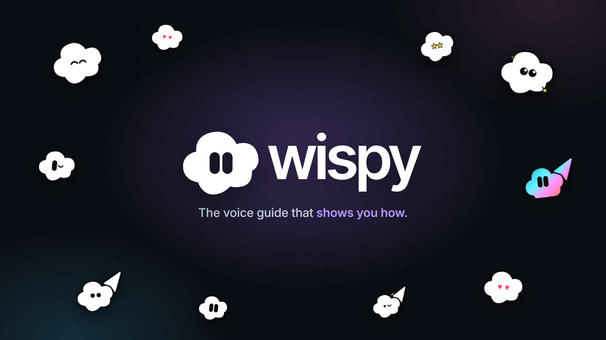

# Wispy AI

**Ask out loud. Wispy shows you how.**

Wispy AI is a voice guide that lives inside software. You talk to it, and instead of reading you a
paragraph, the Wispy mascot flies to the right control on the page, circles it, explains it out
loud, and can fill fields and press buttons for you. Anything that sends, pays or deletes waits for
your Yes.

Built for the [AssemblyAI Voice Agent Hackathon](https://lablab.ai) (September 2026) on
AssemblyAI's **Voice Agent API**: speech-to-text, turn-taking, the language model, the voice and
JSON-Schema tool calling all run through one WebSocket. Wispy's tools are the page's own controls.



- **Demo video:** on the lablab.ai project page
- **Deck:** [docs/Wispy-AI-Deck.pdf](docs/Wispy-AI-Deck.pdf)

## Two ways Wispy uses AssemblyAI

| | Where | AssemblyAI |
|---|---|---|
| **Wispy for the web** (this repo, open source) | One script tag on any page | **Voice Agent API**: speech-to-text, turn-taking, the model, the voice and tool calls in one WebSocket; Wispy's tools are the page's own controls |
| **Wispy on the desktop** (the app in the video, Wispy Console) | Any Windows app | **Universal-3.6 Pro Realtime** streaming: words typed live as you speak, end-of-turn detection so it answers the moment you stop, keyterms built from the controls on screen and updated mid-stream, streaming PII redaction (phone, email, card and ID numbers masked before any model reads them), Voice Focus for noisy rooms, and live partials that let you talk over Wispy to stop it |

The desktop app is closed source; everything needed to put Wispy on a web page is here.

## Try it

- Live demo: see the project page on lablab.ai.
- Locally:

```bash
ASSEMBLYAI_API_KEY=your_key npm run dev
# open http://localhost:5210, click the purple cloud, tap the mic and ask
# "How do I send this invoice?" or "Add ten packets of tea at 250 shillings each"
```

The demo app, *Duka Books*, is made up. Nothing in it sends real invoices or money.

## Add Wispy to a page

```html
<button data-wispy="send-invoice" data-wispy-risky="sends the invoice to the customer">Send invoice</button>
<script src="wispy.js" data-token-url="/api/token" defer></script>
```

- `data-wispy="an-id"` lets Wispy see, point at, fill and press a control.
- `data-wispy-risky="what it does"` makes Wispy show a Yes or No card before pressing it.
- `/api/token` is `api/token.js`: it keeps your AssemblyAI key on the server and hands the browser a
  short-lived session token (60 s to redeem, 10 minute sessions, 5 sessions a minute per address).

## How it works

```
mic (24 kHz PCM16, AudioWorklet)
  -> AssemblyAI Voice Agent API  (wss://agents.assemblyai.com/v1/ws)
       hears, decides when you finished, thinks, speaks
       and calls Wispy's function tools:
         point_at(target)          fly the mascot to a control and ring it
         draw(target, shape)       ring, underline or arrow
         fill_field(target, value) type into a field, visibly
         press(target)             click; risky controls ask Yes or No first
         look()                    the page and its controls right now
  <- reply.audio (spoken answer) + transcript.agent.delta (word timings for captions)
```

- The system prompt and the tools' `enum` of targets are built from the page's own `data-wispy`
  controls when the session starts, so Wispy can only point at things that exist.
- Captions appear word by word, in time with the voice, from the word timings AssemblyAI sends.
- When you start talking, playback stops at once (barge-in) and the panel tucks away if it covers
  the control Wispy is pointing at.

## What was tested

Headless Edge with a recorded voice as the microphone (`scripts/e2e.mjs`), on 28 Sept 2026:

| Asked | What Wispy did |
|---|---|
| "How do I send this invoice?" | pointed at and circled **Send invoice**, explained it |
| "Please add ten packets of tea at two hundred and fifty shillings each." | filled item, quantity and price, pressed **Add line** (total KES 9,840 to 12,340) |
| "Now send the invoice." | showed the Yes / No card; sent only after Yes |
| "Where can I see my payments?" | pointed at **Payments** in the menu |

Known limit: with a spoken greeting on, the first question asked while the greeting still echoed
came back cut short, so the greeting is text only by default.

## The desktop app

Wispy also runs as a Windows desktop app (Wispy Console, not open source), where it hears through
AssemblyAI's **Realtime Speech-to-Text** (Universal-3.5 Pro) and guides you through any program. It
is shown in the demo video.

## Licence

Code: MIT, see `LICENSE`. The Wispy name and mascot belong to Hausor Labs.

Built by Brian Mwai, Hausor Labs, Nairobi. brian@hausorlabs.tech
